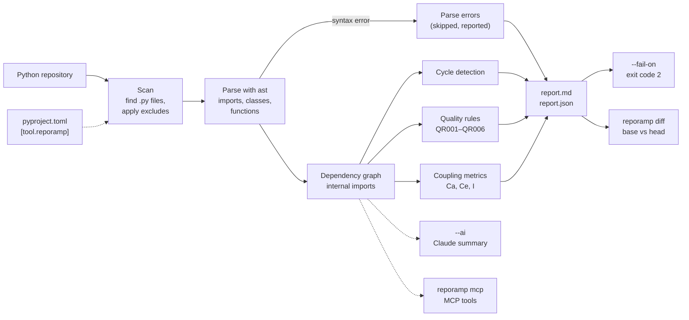
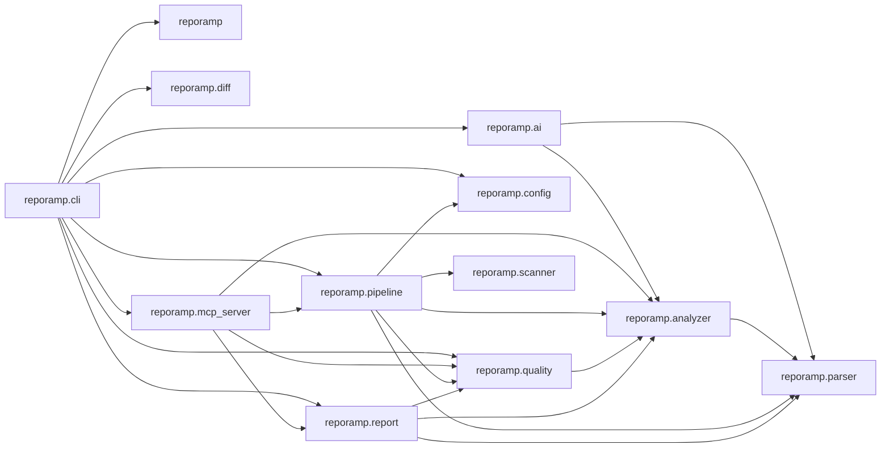

<p align="center">
  
</p>

<h1 align="center">RepoRamp</h1>

<p align="center">
  <strong>Python Codebase Intelligence</strong><br />
  Scan. Understand. Improve.
</p>

<p align="center">
  <a href="https://pypi.org/project/reporamp/"></a>
  
  <a href="https://github.com/launchforgedev/Repo-Ramp/blob/main/LICENSE"></a>
</p>

<p align="center"><strong>Requires Python 3.10 or newer</strong></p>


RepoRamp is a command-line tool that helps developers understand the structure of a Python codebase. It scans Python modules, maps internal imports, detects dependency cycles, flags selected code-quality issues, and generates Markdown and JSON reports.

## Features

- **Python module discovery** — scans Python files while excluding common virtual environments, caches, and build directories.
- **Import and dependency analysis** — identifies relationships between modules in a project.
- **Circular dependency detection** — reports dependency cycles in the internal module graph.
- **Code-quality checks** — reports selected structural issues:
  - `QR001`: empty modules (empty `__init__.py` package markers are ignored)
  - `QR002`: modules with many internal dependencies
  - `QR003`: dependency cycles
  - `QR004`: high fan-in "god modules"
  - `QR005`: orphan modules that nothing imports
  - `QR006`: oversized modules or functions
- **Markdown and JSON reports** — keep a human-readable architecture overview and machine-readable analysis output.
- **Command-line interface** — run the analyzer from the project you want to inspect.

## How it works



Source code is parsed, never executed. Dashed arrows are optional.

## Installation

Requires Python 3.10 or newer.

```bash
python -m pip install reporamp
```

## Quick start

Open a terminal in the Python project you want to analyze, then run:

```bash
cd path/to/your-project
reporamp analyze .
```

To choose an output location:

```bash
reporamp analyze . --output reporamp-report
```

Files that cannot be parsed (for example, syntax errors) are skipped, listed in the console, and recorded in a "Parse Errors" section of both reports. The run still exits with code 0; pass `--strict` to exit with code 1 when any file fails to parse:

```bash
reporamp analyze . --strict
```

### Options

| Option | Default | Description |
| --- | --- | --- |
| `--output`, `-o` | `reporamp-report` | Directory where reports are written. |
| `--format md\|json\|both` | `both` | Which reports to write. |
| `--max-deps INT` | `5` | `QR002` threshold: flag modules with more internal dependencies than this. |
| `--max-fan-in INT` | `10` | `QR004` threshold: flag modules imported by more internal modules than this. |
| `--max-module-lines INT` | `1000` | `QR006` threshold for module length. |
| `--max-function-lines INT` | `100` | `QR006` threshold for function length. |
| `--exclude PATTERN` | — | Glob for files or directories to skip, matched against names and root-relative paths. Repeatable; added to the built-in exclusions (`.venv`, `build`, `__pycache__`, …). |
| `--strict` | off | Exit with code 1 if any file fails to parse. |
| `--fail-on RULES` | — | Comma-separated rule IDs, or `cycles` for `QR003`. Exit with code 2 if any matching finding exists. |

```bash
reporamp analyze . --exclude tests --exclude "migrations/*" --max-deps 8 --format md
```

### Configuration file

RepoRamp reads `[tool.reporamp]` from the analyzed repository's `pyproject.toml`. Command-line flags override these values (a `--exclude` flag replaces the configured list).

```toml
[tool.reporamp]
max_deps = 8
max_fan_in = 10
max_module_lines = 1000
max_function_lines = 100
exclude = ["tests", "migrations/*"]
fail_on = ["QR003", "QR002"]   # or "QR003,QR002"
format = "both"                # md, json or both
```

Unknown keys or invalid values stop the run with an error so typos are not silently ignored.

### CI gating

Use `--fail-on` to fail a CI job when selected rules fire. Reports are still written first.

```bash
reporamp analyze . --fail-on QR003,QR002   # or: --fail-on cycles
```

Exit codes: `0` success, `1` error (or a parse error with `--strict`), `2` a `--fail-on` rule matched.

#### GitHub Action

```yaml
# .github/workflows/reporamp.yml
name: RepoRamp
on: [pull_request]
jobs:
  reporamp:
    runs-on: ubuntu-latest
    steps:
      - uses: actions/checkout@v4
      - uses: launchforgedev/Repo-Ramp@main   # pin to a release tag once available
        with:
          fail-on: QR003,QR002      # "" disables gating
          args: --max-deps 8        # optional extra analyze flags
```

Inputs: `path` (default `.`), `fail-on` (default `QR003`), `output` (default `reporamp-report`), `args`, `python-version` (default `3.12`). Settings in `[tool.reporamp]` still apply.

#### pre-commit

```yaml
# .pre-commit-config.yaml
repos:
  - repo: https://github.com/launchforgedev/Repo-Ramp
    rev: main   # pin to a release tag once available
    hooks:
      - id: reporamp
        args: ["--fail-on", "QR003,QR002"]   # default: --fail-on QR003
```

The hook analyzes the whole repository whenever Python files change, and writes reports to `.reporamp-report/`. Add that directory to `.gitignore`.

See all supported options:

```bash
reporamp analyze --help
```

Check the installed version:

```bash
reporamp version
```

RepoRamp generates Markdown and JSON architecture reports. Use the Markdown report for a quick overview and the JSON report for tooling or further analysis.

## Example report

An analysis report can include:

- Number of Python modules analyzed
- Internal dependency count
- Standard-library and third-party imports
- Unresolved imports
- Dependency cycles
- A Mermaid dependency graph (`flowchart`) of internal edges, with cycle edges highlighted in red. GitHub renders it inline. Large graphs are capped at the 60 most connected modules, and the report says when the graph is truncated.
- Coupling metrics per module: fan-in (Ca), fan-out (Ce) and instability I = Ce / (Ca + Ce). The JSON report lists every module under `coupling` (`instability` is `null` for modules with no internal edges); the Markdown report shows a "Most Coupled Modules" table of the top 10 by Ca + Ce.
- Module imports, classes, and functions
- Code-quality findings and suggestions

### Example: RepoRamp analyzing itself

Output of `reporamp analyze . --exclude tests`. The Markdown report embeds the dependency graph as a Mermaid diagram, which GitHub renders inline; edges that form a cycle are drawn in red (RepoRamp has none):



The "Most Coupled Modules" table from the same report (top rows):

| Module | Fan-in (Ca) | Fan-out (Ce) | Instability (I) |
| --- | ---: | ---: | ---: |
| `reporamp.cli` | 0 | 8 | 1.00 |
| `reporamp.pipeline` | 2 | 5 | 0.71 |
| `reporamp.analyzer` | 5 | 1 | 0.17 |
| `reporamp.mcp_server` | 1 | 4 | 0.80 |
| `reporamp.quality` | 4 | 1 | 0.20 |
| `reporamp.report` | 2 | 3 | 0.60 |

## AI architecture summary (optional)

`reporamp analyze --ai` adds an "Architecture Summary" section to the Markdown report, written by Claude (`claude-opus-5-5`) through the Anthropic SDK:

```bash
python -m pip install "reporamp[ai]"
export ANTHROPIC_API_KEY=...
reporamp analyze . --ai
```

Only the structured analysis context is sent: repo-relative module paths, internal dependency edges, the unresolved-import count and dependency cycles. Source code is never sent. If `ANTHROPIC_API_KEY` is unset, the SDK is not installed, or the request fails, RepoRamp prints why and writes the built-in local summary instead. The run still succeeds.

## MCP server (optional)

`reporamp mcp` runs a [Model Context Protocol](https://modelcontextprotocol.io) server over stdio, so MCP clients (for example Claude Code or Claude Desktop) can query a repository's structure:

```bash
python -m pip install "reporamp[mcp]"
claude mcp add reporamp -- reporamp mcp   # Claude Code
```

| Tool | Returns |
| --- | --- |
| `analyze_repo(path)` | The full JSON report |
| `get_cycles(path)` | Dependency cycles as lists of module names |
| `who_imports(path, module)` | Internal modules that import `module` (a dotted name such as `app.models`) |
| `get_findings(path, rule_id?)` | Quality findings, optionally filtered by rule ID (or `cycles`) |

Each call analyzes the repository at `path` with its `[tool.reporamp]` settings.

## Comparing reports

`reporamp diff` compares two JSON reports, for example from `main` and from a pull request branch:

```bash
reporamp analyze . --format json -o base-report     # on main
reporamp analyze . --format json -o head-report     # on your branch
reporamp diff base-report/report.json head-report/report.json --fail-on-new
```

It prints added and removed modules and dependencies, plus new and resolved cycles and findings. Findings are matched by rule ID, module and message, so a finding whose message changes (for example a different dependency count) shows as one resolved and one new finding. With `--fail-on-new`, the command exits with code 2 if the head report has any new cycle or finding.

## JSON report schema

`report.json` has a top-level `schema_version`. It is bumped whenever the structure of the report changes, so tools can detect which fields to expect. `reporamp diff` accepts versions 1 and 2.

| Version | Changes |
| --- | --- |
| `1` | `summary`, `quality_findings`, `modules`, `dependencies`, `standard_library_imports`, `third_party_imports`, `unresolved_imports`, `dependency_cycles` |
| `2` | Adds `parse_errors` (list of `{path, error}`), `summary.parse_errors`, and `coupling` (list of `{module, fan_in, fan_out, instability}`) |

All lists are sorted, so reports for the same code are byte-for-byte identical.

## Quality rules

| Rule | What it checks |
| --- | --- |
| `QR001` | Empty Python modules (empty `__init__.py` files are ignored) |
| `QR002` | Modules with more outgoing internal dependencies than the configured threshold |
| `QR003` | Circular dependencies in the module graph |
| `QR004` | "God modules" imported by more internal modules than `--max-fan-in` (default 10) |
| `QR005` | Orphan modules (severity `info`) that no other module imports. Packages, `__main__`, `conftest`, `setup`, `test_*`/`*_test` modules and `[project.scripts]`/`gui-scripts` targets count as entry points and are skipped |
| `QR006` | Modules longer than `--max-module-lines` (default 1000) or functions longer than `--max-function-lines` (default 100) |

These checks are structural signals to help guide code review; they do not replace tests, linting, or human judgment.

## Development

Clone the repository and install the project in editable mode with its development dependencies:

```bash
git clone https://github.com/launchforgedev/Repo-Ramp.git
cd Repo-Ramp
python -m pip install -e ".[dev]"
```

Run the tests:

```bash
pytest
```

## Continuous integration and releases

- `.github/workflows/ci.yml` runs `ruff check .` and `pytest` on Python 3.10–3.13 for every push to `main` and every pull request.
- `.github/workflows/release.yml` builds the package and publishes it to PyPI with [trusted publishing](https://docs.pypi.org/trusted-publishers/) when a `v*` tag is pushed (for example `v0.2.0`). It requires a `pypi` environment in the repository settings and a matching trusted publisher on PyPI.

## Current scope

RepoRamp focuses on static structural analysis of Python projects. AI-powered summaries are optional and off by default (see [AI architecture summary](#ai-architecture-summary-optional)).

## Contributing

Issues, bug reports, and pull requests are welcome. Please include a clear description of the change and tests for new behavior where practical.

## License

RepoRamp is released under the MIT License. See [LICENSE](LICENSE).

## Links

- [PyPI package](https://pypi.org/project/reporamp/)
- [GitHub repository](https://github.com/launchforgedev/Repo-Ramp)
