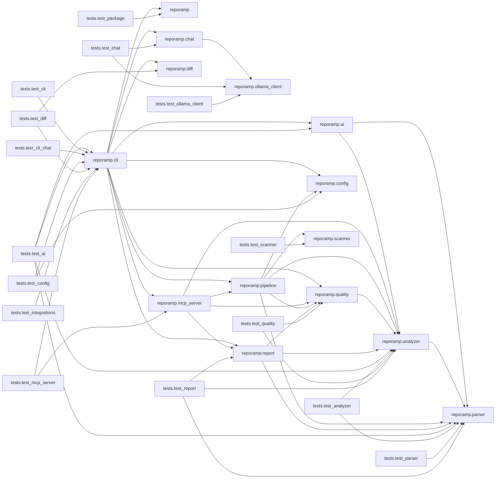

# RepoRamp Architecture Report

## Summary

- Python modules analyzed: 29
- Internal dependencies: 52
- Standard-library imports: 66
- Third-party imports: 22
- Unresolved imports: 2
- Dependency cycles: 0
- Files with parse errors: 0

## Architecture Summary

The repository contains 29 Python modules and 52 internal dependencies.
It has 2 unresolved imports and 0 dependency cycles.
Module relationships:
- reporamp.ai depends on reporamp.analyzer.
- reporamp.ai depends on reporamp.parser.
- reporamp.analyzer depends on reporamp.parser.
- reporamp.chat depends on reporamp.ollama_client.
- reporamp.cli depends on reporamp.
- reporamp.cli depends on reporamp.ai.
- reporamp.cli depends on reporamp.chat.
- reporamp.cli depends on reporamp.config.
- reporamp.cli depends on reporamp.diff.
- reporamp.cli depends on reporamp.mcp_server.
- reporamp.cli depends on reporamp.pipeline.
- reporamp.cli depends on reporamp.quality.
- reporamp.cli depends on reporamp.report.
- reporamp.mcp_server depends on reporamp.analyzer.
- reporamp.mcp_server depends on reporamp.pipeline.
- reporamp.mcp_server depends on reporamp.quality.
- reporamp.mcp_server depends on reporamp.report.
- reporamp.pipeline depends on reporamp.analyzer.
- reporamp.pipeline depends on reporamp.config.
- reporamp.pipeline depends on reporamp.parser.
- reporamp.pipeline depends on reporamp.quality.
- reporamp.pipeline depends on reporamp.scanner.
- reporamp.quality depends on reporamp.analyzer.
- reporamp.report depends on reporamp.analyzer.
- reporamp.report depends on reporamp.parser.
- reporamp.report depends on reporamp.quality.
- tests.test_ai depends on reporamp.ai.
- tests.test_ai depends on reporamp.analyzer.
- tests.test_ai depends on reporamp.cli.
- tests.test_ai depends on reporamp.parser.
- tests.test_analyzer depends on reporamp.analyzer.
- tests.test_analyzer depends on reporamp.parser.
- tests.test_chat depends on reporamp.chat.
- tests.test_chat depends on reporamp.ollama_client.
- tests.test_cli depends on reporamp.cli.
- tests.test_cli_chat depends on reporamp.cli.
- tests.test_config depends on reporamp.cli.
- tests.test_config depends on reporamp.config.
- tests.test_diff depends on reporamp.cli.
- tests.test_diff depends on reporamp.diff.
- tests.test_integrations depends on reporamp.cli.
- tests.test_mcp_server depends on reporamp.cli.
- tests.test_mcp_server depends on reporamp.mcp_server.
- tests.test_ollama_client depends on reporamp.ollama_client.
- tests.test_package depends on reporamp.
- tests.test_parser depends on reporamp.parser.
- tests.test_quality depends on reporamp.analyzer.
- tests.test_quality depends on reporamp.quality.
- tests.test_report depends on reporamp.analyzer.
- tests.test_report depends on reporamp.parser.
- tests.test_report depends on reporamp.report.
- tests.test_scanner depends on reporamp.scanner.

## Modules

### `src/reporamp/__init__.py`

#### Imports

- None

#### Classes

- None

#### Functions and methods

- None

### `src/reporamp/ai.py`

#### Imports

- Line 4: `json`
- Line 5: `os`
- Line 6: `pathlib:Path`
- Line 8: `reporamp.analyzer:DependencyGraph`
- Line 8: `reporamp.analyzer:classify_import`
- Line 8: `reporamp.analyzer:find_dependency_cycles`
- Line 13: `reporamp.parser:ModuleInfo`
- Line 120: `anthropic`

#### Classes

- `AISummaryUnavailable` (Exception) — line 100

#### Functions and methods

- `build_analysis_context` (function) — line 16
- `display` (function) — line 31
- `generate_architecture_summary` (function) — line 55
- `generate_ai_summary` (function) — line 104

### `src/reporamp/analyzer.py`

#### Imports

- Line 3: `sys`
- Line 4: `dataclasses:dataclass`
- Line 5: `importlib.util:find_spec`
- Line 6: `pathlib:Path`
- Line 8: `reporamp.parser:ModuleInfo`

#### Classes

- `DependencyEdge` — line 12
- `DependencyGraph` — line 20
- `ModuleCoupling` — line 149

#### Functions and methods

- `_module_name` (function) — line 29
- `_resolve_internal_import` (function) — line 46
- `analyze_dependencies` (function) — line 68
- `instability` (method) in `ModuleCoupling` — line 157
- `coupling_metrics` (function) — line 163
- `find_dependency_cycles` (function) — line 178
- `visit` (function) — line 195
- `classify_import` (function) — line 217

### `src/reporamp/chat.py`

#### Imports

- Line 4: `pathlib:Path`
- Line 6: `typer`
- Line 8: `reporamp.ollama_client:OllamaChatClient`
- Line 8: `reporamp.ollama_client:OllamaClientError`

#### Classes

- None

#### Functions and methods

- `select_model` (function) — line 14
- `run_chat` (function) — line 61

### `src/reporamp/cli.py`

#### Imports

- Line 3: `os`
- Line 4: `subprocess`
- Line 5: `sys`
- Line 6: `enum:Enum`
- Line 7: `pathlib:Path`
- Line 8: `typing:Annotated`
- Line 10: `typer`
- Line 12: `reporamp.ai:AISummaryUnavailable`
- Line 12: `reporamp.ai:build_analysis_context`
- Line 12: `reporamp.ai:generate_ai_summary`
- Line 12: `reporamp.ai:generate_architecture_summary`
- Line 18: `reporamp.config:DEFAULTS`
- Line 18: `reporamp.config:load_config`
- Line 19: `reporamp.diff:diff_reports`
- Line 19: `reporamp.diff:has_new_problems`
- Line 19: `reporamp.diff:load_report`
- Line 19: `reporamp.diff:render_diff`
- Line 20: `reporamp.pipeline:run_analysis`
- Line 21: `reporamp.quality:parse_rule_selection`
- Line 21: `reporamp.quality:select_findings`
- Line 22: `reporamp.report:write_reports`
- Line 90: `reporamp.chat:run_chat`
- Line 99: `reporamp:__version__`
- Line 415: `reporamp.chat:run_chat`
- Line 459: `reporamp.mcp_server:create_server`

#### Classes

- `ReportFormat` (str, Enum) — line 31

#### Functions and methods

- `print_banner` (function) — line 39
- `launch_chat_terminal` (function) — line 60
- `version` (function) — line 97
- `analyze` (function) — line 105
- `chat` (function) — line 380
- `diff` (function) — line 425
- `mcp` (function) — line 456

### `src/reporamp/config.py`

#### Imports

- Line 3: `sys`
- Line 4: `pathlib:Path`
- Line 7: `tomllib`
- Line 9: `tomli as tomllib`

#### Classes

- None

#### Functions and methods

- `_string_list` (function) — line 24
- `load_config` (function) — line 30
- `load_entry_points` (function) — line 71

### `src/reporamp/diff.py`

#### Imports

- Line 3: `json`
- Line 4: `pathlib:Path`

#### Classes

- None

#### Functions and methods

- `load_report` (function) — line 9
- `_changes` (function) — line 20
- `diff_reports` (function) — line 24
- `modules` (function) — line 30
- `dependencies` (function) — line 33
- `cycles` (function) — line 38
- `findings` (function) — line 41
- `has_new_problems` (function) — line 55
- `_describe` (function) — line 68
- `render_diff` (function) — line 78

### `src/reporamp/mcp_server.py`

#### Imports

- Line 8: `json`
- Line 9: `pathlib:Path`
- Line 11: `reporamp.analyzer:find_dependency_cycles`
- Line 12: `reporamp.pipeline:Analysis`
- Line 12: `reporamp.pipeline:run_configured_analysis`
- Line 13: `reporamp.quality:parse_rule_selection`
- Line 13: `reporamp.quality:select_findings`
- Line 14: `reporamp.report:render_json`
- Line 85: `mcp.server.mcpserver:MCPServer`

#### Classes

- None

#### Functions and methods

- `_analyze` (function) — line 17
- `analyze_repo` (function) — line 26
- `get_cycles` (function) — line 41
- `who_imports` (function) — line 48
- `get_findings` (function) — line 60
- `create_server` (function) — line 83

### `src/reporamp/ollama_client.py`

#### Imports

- Line 3: `collections.abc:Iterator`
- Line 4: `typing:Any`
- Line 35: `ollama`

#### Classes

- `OllamaClientError` (RuntimeError) — line 9
- `OllamaChatClient` — line 13

#### Functions and methods

- `__init__` (method) in `OllamaChatClient` — line 16
- `list_models` (method) in `OllamaChatClient` — line 46
- `set_model` (method) in `OllamaChatClient` — line 79
- `stream_answer` (method) in `OllamaChatClient` — line 86

### `src/reporamp/parser.py`

#### Imports

- Line 3: `ast`
- Line 4: `tokenize`
- Line 5: `dataclasses:dataclass`
- Line 6: `pathlib:Path`

#### Classes

- `ImportInfo` — line 10
- `FunctionInfo` — line 21
- `ClassInfo` — line 32
- `ModuleInfo` — line 42
- `_ModuleVisitor` (ast.NodeVisitor) — line 59

#### Functions and methods

- `_expression_name` (function) — line 51
- `__init__` (method) in `_ModuleVisitor` — line 62
- `visit_Import` (method) in `_ModuleVisitor` — line 68
- `visit_ImportFrom` (method) in `_ModuleVisitor` — line 80
- `visit_ClassDef` (method) in `_ModuleVisitor` — line 92
- `visit_FunctionDef` (method) in `_ModuleVisitor` — line 108
- `visit_AsyncFunctionDef` (method) in `_ModuleVisitor` — line 111
- `_record_function` (method) in `_ModuleVisitor` — line 114
- `parse_python_file` (function) — line 134

### `src/reporamp/pipeline.py`

#### Imports

- Line 3: `dataclasses:dataclass`
- Line 4: `pathlib:Path`
- Line 6: `reporamp.analyzer:DependencyGraph`
- Line 6: `reporamp.analyzer:_module_name`
- Line 6: `reporamp.analyzer:analyze_dependencies`
- Line 7: `reporamp.config:DEFAULTS`
- Line 7: `reporamp.config:load_config`
- Line 7: `reporamp.config:load_entry_points`
- Line 8: `reporamp.parser:ModuleInfo`
- Line 8: `reporamp.parser:parse_python_file`
- Line 9: `reporamp.quality:Finding`
- Line 9: `reporamp.quality:analyze_quality`
- Line 10: `reporamp.scanner:scan_repository`

#### Classes

- `Analysis` — line 14

#### Functions and methods

- `run_analysis` (function) — line 24
- `run_configured_analysis` (function) — line 59

### `src/reporamp/quality.py`

#### Imports

- Line 1: `ast`
- Line 2: `dataclasses:dataclass`
- Line 3: `pathlib:Path`
- Line 5: `reporamp.analyzer:DependencyGraph`
- Line 5: `reporamp.analyzer:find_dependency_cycles`

#### Classes

- `Finding` — line 14

#### Functions and methods

- `find_empty_modules` (function) — line 22
- `find_high_dependency_modules` (function) — line 66
- `find_cycle_findings` (function) — line 100
- `find_high_fan_in_modules` (function) — line 124
- `_is_entry_point` (function) — line 153
- `find_orphan_modules` (function) — line 163
- `find_oversized_code` (function) — line 188
- `analyze_quality` (function) — line 243
- `parse_rule_selection` (function) — line 275
- `select_findings` (function) — line 292

### `src/reporamp/report.py`

#### Imports

- Line 3: `json`
- Line 4: `pathlib:Path`
- Line 6: `reporamp.analyzer:DependencyGraph`
- Line 6: `reporamp.analyzer:classify_import`
- Line 6: `reporamp.analyzer:coupling_metrics`
- Line 6: `reporamp.analyzer:find_dependency_cycles`
- Line 12: `reporamp.parser:ModuleInfo`
- Line 13: `reporamp.quality:Finding`

#### Classes

- None

#### Functions and methods

- `_classify_unresolved_imports` (function) — line 16
- `_render_mermaid` (function) — line 38
- `_display_path` (function) — line 92
- `render_markdown` (function) — line 102
- `render_json` (function) — line 282
- `write_reports` (function) — line 384

### `src/reporamp/scanner.py`

#### Imports

- Line 4: `os`
- Line 5: `collections.abc:Iterable`
- Line 6: `fnmatch:fnmatch`
- Line 7: `pathlib:Path`

#### Classes

- None

#### Functions and methods

- `_is_excluded` (function) — line 29
- `scan_repository` (function) — line 38

### `tests/test_ai.py`

#### Imports

- Line 1: `json`
- Line 2: `sys`
- Line 3: `pathlib:Path`
- Line 4: `types:ModuleType`
- Line 4: `types:SimpleNamespace`
- Line 6: `pytest`
- Line 7: `typer.testing:CliRunner`
- Line 9: `reporamp.ai:AI_MODEL`
- Line 9: `reporamp.ai:AISummaryUnavailable`
- Line 9: `reporamp.ai:build_analysis_context`
- Line 9: `reporamp.ai:generate_ai_summary`
- Line 9: `reporamp.ai:generate_architecture_summary`
- Line 16: `reporamp.analyzer:DependencyEdge`
- Line 16: `reporamp.analyzer:DependencyGraph`
- Line 17: `reporamp.cli:app`
- Line 18: `reporamp.parser:ModuleInfo`

#### Classes

- `_FakeAPIError` (Exception) — line 116
- `_Messages` — line 125
- `_Client` — line 138

#### Functions and methods

- `test_build_analysis_context_for_empty_repository` (function) — line 23
- `test_unresolved_import_count_excludes_known_imports` (function) — line 42
- `test_build_analysis_context_with_dependency` (function) — line 57
- `test_generate_architecture_summary` (function) — line 93
- `_install_fake_sdk` (function) — line 120
- `create` (method) in `_Messages` — line 126
- `__init__` (method) in `_Client` — line 139
- `test_generate_ai_summary_sends_only_context` (function) — line 151
- `test_generate_ai_summary_requires_api_key` (function) — line 162
- `test_generate_ai_summary_requires_sdk` (function) — line 169
- `test_generate_ai_summary_failures` (function) — line 185
- `test_context_paths_are_relative_to_root` (function) — line 192
- `test_cli_ai_uses_claude_summary` (function) — line 203
- `test_cli_ai_falls_back_to_local_summary` (function) — line 215
- `test_cli_without_ai_has_no_summary` (function) — line 228

### `tests/test_analyzer.py`

#### Imports

- Line 1: `pathlib:Path`
- Line 3: `reporamp.analyzer:DependencyEdge`
- Line 3: `reporamp.analyzer:DependencyGraph`
- Line 3: `reporamp.analyzer:analyze_dependencies`
- Line 3: `reporamp.analyzer:classify_import`
- Line 3: `reporamp.analyzer:coupling_metrics`
- Line 3: `reporamp.analyzer:find_dependency_cycles`
- Line 11: `reporamp.parser:parse_python_file`

#### Classes

- None

#### Functions and methods

- `_parse` (function) — line 14
- `test_detects_internal_import_chain` (function) — line 18
- `test_reports_unresolved_imports` (function) — line 46
- `test_finds_dependency_cycle` (function) — line 59
- `test_acyclic_graph_has_no_cycles` (function) — line 73
- `test_graph_output_is_deterministic` (function) — line 86
- `test_classifies_standard_library_imports` (function) — line 107
- `test_classifies_installed_third_party_imports` (function) — line 113
- `test_classifies_unknown_imports` (function) — line 117
- `test_classifies_empty_import` (function) — line 121
- `_write_app_package` (function) — line 124
- `test_from_package_import_submodules` (function) — line 137
- `test_relative_from_dot_import_submodules` (function) — line 154
- `test_coupling_metrics` (function) — line 183

### `tests/test_chat.py`

#### Imports

- Line 2: `pathlib:Path`
- Line 3: `unittest.mock:Mock`
- Line 5: `pytest`
- Line 6: `typer`
- Line 8: `reporamp.chat:run_chat`
- Line 8: `reporamp.chat:select_model`
- Line 9: `reporamp.ollama_client:OllamaClientError`

#### Classes

- None

#### Functions and methods

- `test_missing_report_exits` (function) — line 12
- `test_selects_explicit_model` (function) — line 22
- `test_selects_only_installed_model` (function) — line 31
- `test_prompts_when_multiple_models_are_installed` (function) — line 42
- `test_reprompts_for_invalid_model_number` (function) — line 53
- `test_exits_when_no_models_are_installed` (function) — line 66
- `test_exits_when_model_discovery_fails` (function) — line 77

### `tests/test_cli.py`

#### Imports

- Line 1: `json`
- Line 2: `pathlib:Path`
- Line 4: `typer.testing:CliRunner`
- Line 6: `reporamp.cli:app`

#### Classes

- None

#### Functions and methods

- `test_analyze_generates_reports` (function) — line 11
- `test_analyze_rejects_missing_directory` (function) — line 32
- `test_help_is_available` (function) — line 40
- `test_analyze_continues_past_invalid_python` (function) — line 47
- `test_analyze_strict_fails_on_invalid_python` (function) — line 65
- `_write_hub` (function) — line 78
- `test_analyze_max_deps_controls_qr002` (function) — line 88
- `test_analyze_exclude_and_format` (function) — line 106
- `test_analyze_rejects_unknown_format` (function) — line 135
- `_write_cycle` (function) — line 141
- `test_fail_on_exits_2_for_matching_findings` (function) — line 146
- `test_fail_on_passes_without_matching_findings` (function) — line 160
- `test_fail_on_rejects_unknown_rule` (function) — line 171
- `test_new_rule_thresholds_and_console_scripts` (function) — line 178

### `tests/test_cli_chat.py`

#### Imports

- Line 1: `pathlib:Path`
- Line 3: `typer.testing:CliRunner`
- Line 5: `reporamp.cli:app`

#### Classes

- None

#### Functions and methods

- `test_chat_command_help` (function) — line 10
- `test_ask_rejects_markdown_only_output` (function) — line 19
- `test_existing_analyze_help_still_works` (function) — line 35

### `tests/test_config.py`

#### Imports

- Line 1: `json`
- Line 2: `pathlib:Path`
- Line 4: `pytest`
- Line 5: `typer.testing:CliRunner`
- Line 7: `reporamp.cli:app`
- Line 8: `reporamp.config:load_config`

#### Classes

- None

#### Functions and methods

- `_write_pyproject` (function) — line 13
- `test_missing_pyproject_returns_empty_config` (function) — line 20
- `test_loads_all_settings` (function) — line 24
- `test_rejects_invalid_settings` (function) — line 43
- `test_cli_uses_config_and_flags_override` (function) — line 50
- `test_cli_reports_invalid_config` (function) — line 90

### `tests/test_diff.py`

#### Imports

- Line 1: `json`
- Line 2: `pathlib:Path`
- Line 4: `pytest`
- Line 5: `typer.testing:CliRunner`
- Line 7: `reporamp.cli:app`
- Line 8: `reporamp.diff:diff_reports`
- Line 8: `reporamp.diff:has_new_problems`
- Line 8: `reporamp.diff:load_report`
- Line 8: `reporamp.diff:render_diff`

#### Classes

- None

#### Functions and methods

- `_analyze` (function) — line 13
- `test_diff_detects_changes_between_reports` (function) — line 19
- `test_load_report_accepts_schema_v1` (function) — line 64
- `test_load_report_rejects_unknown_schema` (function) — line 72

### `tests/test_integrations.py`

#### Imports

- Line 1: `ast`
- Line 2: `shlex`
- Line 3: `pathlib:Path`
- Line 5: `typer.testing:CliRunner`
- Line 7: `reporamp.cli:app`

#### Classes

- None

#### Functions and methods

- `_hook_value` (function) — line 12
- `test_pre_commit_hook_command_fails_on_cycles` (function) — line 19
- `test_action_runs_reporamp_with_fail_on` (function) — line 32

### `tests/test_mcp_server.py`

#### Imports

- Line 1: `asyncio`
- Line 2: `sys`
- Line 3: `pathlib:Path`
- Line 5: `pytest`
- Line 6: `typer.testing:CliRunner`
- Line 8: `reporamp.cli:app`
- Line 9: `reporamp.mcp_server:TOOLS`
- Line 9: `reporamp.mcp_server:analyze_repo`
- Line 9: `reporamp.mcp_server:get_cycles`
- Line 9: `reporamp.mcp_server:get_findings`
- Line 9: `reporamp.mcp_server:who_imports`
- Line 74: `reporamp.mcp_server:create_server`

#### Classes

- None

#### Functions and methods

- `repo` (function) — line 19
- `test_analyze_repo_returns_json_report` (function) — line 27
- `test_get_cycles` (function) — line 35
- `test_who_imports` (function) — line 39
- `test_get_findings` (function) — line 47
- `test_tools_reject_missing_directory` (function) — line 59
- `test_tools_respect_pyproject_config` (function) — line 64
- `test_server_registers_tools` (function) — line 72
- `test_cli_mcp_reports_missing_extra` (function) — line 81

### `tests/test_ollama_client.py`

#### Imports

- Line 2: `types:SimpleNamespace`
- Line 4: `pytest`
- Line 6: `reporamp.ollama_client:OllamaChatClient`
- Line 6: `reporamp.ollama_client:OllamaClientError`

#### Classes

- `FakeOllama` — line 12

#### Functions and methods

- `__init__` (method) in `FakeOllama` — line 13
- `chat` (method) in `FakeOllama` — line 19
- `list` (method) in `FakeOllama` — line 27
- `make_chunk` (function) — line 32
- `test_streams_response_chunks` (function) — line 36
- `test_passes_question_and_context_to_model` (function) — line 57
- `test_rejects_empty_question` (function) — line 74
- `test_wraps_ollama_errors` (function) — line 84
- `test_rejects_empty_model` (function) — line 92
- `test_supports_dictionary_response_chunks` (function) — line 97
- `test_lists_installed_models` (function) — line 106
- `test_lists_no_installed_models` (function) — line 122

### `tests/test_package.py`

#### Imports

- Line 1: `pathlib:Path`
- Line 3: `reporamp:__version__`

#### Classes

- None

#### Functions and methods

- `test_package_has_expected_initial_version` (function) — line 6
- `test_license_file_exists` (function) — line 10

### `tests/test_parser.py`

#### Imports

- Line 1: `pathlib:Path`
- Line 3: `pytest`
- Line 5: `reporamp.parser:parse_python_file`

#### Classes

- None

#### Functions and methods

- `test_extracts_imports_functions_and_classes` (function) — line 8
- `test_extracts_async_functions` (function) — line 47
- `test_extracts_relative_imports` (function) — line 61
- `test_reports_syntax_errors` (function) — line 74
- `test_missing_file_raises_clear_error` (function) — line 82
- `test_does_not_execute_source_code` (function) — line 87
- `test_reports_source_line_numbers` (function) — line 101

### `tests/test_quality.py`

#### Imports

- Line 1: `dataclasses:FrozenInstanceError`
- Line 2: `pathlib:Path`
- Line 4: `pytest`
- Line 6: `reporamp.analyzer:DependencyEdge`
- Line 6: `reporamp.analyzer:DependencyGraph`
- Line 7: `reporamp.quality:Finding`
- Line 7: `reporamp.quality:analyze_quality`
- Line 7: `reporamp.quality:find_cycle_findings`
- Line 7: `reporamp.quality:find_empty_modules`
- Line 7: `reporamp.quality:find_high_dependency_modules`
- Line 7: `reporamp.quality:find_high_fan_in_modules`
- Line 7: `reporamp.quality:find_orphan_modules`
- Line 7: `reporamp.quality:find_oversized_code`
- Line 7: `reporamp.quality:parse_rule_selection`
- Line 7: `reporamp.quality:select_findings`

#### Classes

- None

#### Functions and methods

- `test_finding_stores_its_fields` (function) — line 21
- `test_finding_is_immutable` (function) — line 37
- `test_detects_empty_module` (function) — line 49
- `test_does_not_flag_module_with_function` (function) — line 60
- `test_does_not_flag_docstring_only_module` (function) — line 72
- `test_detects_module_with_too_many_dependencies` (function) — line 85
- `test_does_not_flag_module_at_threshold` (function) — line 107
- `test_counts_distinct_dependencies_only` (function) — line 125
- `test_detects_circular_dependency` (function) — line 144
- `test_no_findings_for_acyclic_dependencies` (function) — line 163
- `test_analyze_quality_combines_findings` (function) — line 178
- `test_does_not_flag_empty_package_init` (function) — line 208
- `test_parse_rule_selection_accepts_ids_and_aliases` (function) — line 219
- `test_parse_rule_selection_rejects_unknown_rules` (function) — line 225
- `test_select_findings_filters_by_rule` (function) — line 230
- `test_detects_high_fan_in_module` (function) — line 239
- `test_detects_orphan_modules_but_not_entry_points` (function) — line 259
- `test_detects_oversized_modules_and_functions` (function) — line 287

### `tests/test_report.py`

#### Imports

- Line 1: `json`
- Line 2: `pathlib:Path`
- Line 4: `pytest`
- Line 6: `reporamp.analyzer:DependencyEdge`
- Line 6: `reporamp.analyzer:DependencyGraph`
- Line 6: `reporamp.analyzer:analyze_dependencies`
- Line 7: `reporamp.parser:parse_python_file`
- Line 8: `reporamp.report:render_json`
- Line 8: `reporamp.report:render_markdown`
- Line 8: `reporamp.report:write_reports`

#### Classes

- None

#### Functions and methods

- `build_analysis` (function) — line 11
- `test_markdown_contains_summary_and_definitions` (function) — line 38
- `test_json_has_expected_schema` (function) — line 50
- `test_json_output_is_deterministic` (function) — line 61
- `test_writes_both_report_files` (function) — line 70
- `test_rejects_file_as_output_directory` (function) — line 87
- `test_empty_analysis_produces_valid_reports` (function) — line 96
- `test_write_reports_markdown_only` (function) — line 110
- `test_markdown_includes_mermaid_graph_with_cycle_edges` (function) — line 119
- `test_mermaid_graph_is_truncated_to_most_connected_nodes` (function) — line 147
- `test_reports_include_coupling_metrics` (function) — line 162

### `tests/test_scanner.py`

#### Imports

- Line 1: `pathlib:Path`
- Line 3: `pytest`
- Line 5: `reporamp.scanner:scan_repository`

#### Classes

- None

#### Functions and methods

- `test_finds_python_files_recursively` (function) — line 8
- `test_excludes_generated_and_environment_directories` (function) — line 20
- `test_ignores_non_python_files` (function) — line 33
- `test_raises_for_missing_directory` (function) — line 40
- `test_raises_for_file_instead_of_directory` (function) — line 47
- `test_returns_deterministic_order` (function) — line 55
- `test_exclude_patterns_skip_files_and_directories` (function) — line 66

## Internal Dependencies

- `reporamp.ai` → `reporamp.analyzer`
- `reporamp.ai` → `reporamp.parser`
- `reporamp.analyzer` → `reporamp.parser`
- `reporamp.chat` → `reporamp.ollama_client`
- `reporamp.cli` → `reporamp`
- `reporamp.cli` → `reporamp.ai`
- `reporamp.cli` → `reporamp.chat`
- `reporamp.cli` → `reporamp.config`
- `reporamp.cli` → `reporamp.diff`
- `reporamp.cli` → `reporamp.mcp_server`
- `reporamp.cli` → `reporamp.pipeline`
- `reporamp.cli` → `reporamp.quality`
- `reporamp.cli` → `reporamp.report`
- `reporamp.mcp_server` → `reporamp.analyzer`
- `reporamp.mcp_server` → `reporamp.pipeline`
- `reporamp.mcp_server` → `reporamp.quality`
- `reporamp.mcp_server` → `reporamp.report`
- `reporamp.pipeline` → `reporamp.analyzer`
- `reporamp.pipeline` → `reporamp.config`
- `reporamp.pipeline` → `reporamp.parser`
- `reporamp.pipeline` → `reporamp.quality`
- `reporamp.pipeline` → `reporamp.scanner`
- `reporamp.quality` → `reporamp.analyzer`
- `reporamp.report` → `reporamp.analyzer`
- `reporamp.report` → `reporamp.parser`
- `reporamp.report` → `reporamp.quality`
- `tests.test_ai` → `reporamp.ai`
- `tests.test_ai` → `reporamp.analyzer`
- `tests.test_ai` → `reporamp.cli`
- `tests.test_ai` → `reporamp.parser`
- `tests.test_analyzer` → `reporamp.analyzer`
- `tests.test_analyzer` → `reporamp.parser`
- `tests.test_chat` → `reporamp.chat`
- `tests.test_chat` → `reporamp.ollama_client`
- `tests.test_cli` → `reporamp.cli`
- `tests.test_cli_chat` → `reporamp.cli`
- `tests.test_config` → `reporamp.cli`
- `tests.test_config` → `reporamp.config`
- `tests.test_diff` → `reporamp.cli`
- `tests.test_diff` → `reporamp.diff`
- `tests.test_integrations` → `reporamp.cli`
- `tests.test_mcp_server` → `reporamp.cli`
- `tests.test_mcp_server` → `reporamp.mcp_server`
- `tests.test_ollama_client` → `reporamp.ollama_client`
- `tests.test_package` → `reporamp`
- `tests.test_parser` → `reporamp.parser`
- `tests.test_quality` → `reporamp.analyzer`
- `tests.test_quality` → `reporamp.quality`
- `tests.test_report` → `reporamp.analyzer`
- `tests.test_report` → `reporamp.parser`
- `tests.test_report` → `reporamp.report`
- `tests.test_scanner` → `reporamp.scanner`

## Dependency Graph

Edges that are part of a dependency cycle are shown in red.

## Most Coupled Modules

Fan-in (Ca) counts modules that import this one; fan-out (Ce) counts modules it imports. Instability I = Ce / (Ca + Ce).

| Module | Fan-in (Ca) | Fan-out (Ce) | Instability (I) |
| --- | ---: | ---: | ---: |
| `reporamp.cli` | 7 | 9 | 0.56 |
| `reporamp.analyzer` | 9 | 1 | 0.10 |
| `reporamp.parser` | 8 | 0 | 0.00 |
| `reporamp.pipeline` | 2 | 5 | 0.71 |
| `reporamp.mcp_server` | 2 | 4 | 0.67 |
| `reporamp.quality` | 5 | 1 | 0.17 |
| `reporamp.report` | 3 | 3 | 0.50 |
| `reporamp.ai` | 2 | 2 | 0.50 |
| `tests.test_ai` | 0 | 4 | 1.00 |
| `reporamp.chat` | 2 | 1 | 0.33 |

## Standard Library Imports

- `reporamp.ai` imports `json`
- `reporamp.ai` imports `os`
- `reporamp.ai` imports `pathlib`
- `reporamp.analyzer` imports `dataclasses`
- `reporamp.analyzer` imports `importlib.util`
- `reporamp.analyzer` imports `pathlib`
- `reporamp.analyzer` imports `sys`
- `reporamp.chat` imports `pathlib`
- `reporamp.cli` imports `enum`
- `reporamp.cli` imports `os`
- `reporamp.cli` imports `pathlib`
- `reporamp.cli` imports `subprocess`
- `reporamp.cli` imports `sys`
- `reporamp.cli` imports `typing`
- `reporamp.config` imports `pathlib`
- `reporamp.config` imports `sys`
- `reporamp.config` imports `tomllib`
- `reporamp.diff` imports `json`
- `reporamp.diff` imports `pathlib`
- `reporamp.mcp_server` imports `json`
- `reporamp.mcp_server` imports `pathlib`
- `reporamp.ollama_client` imports `collections.abc`
- `reporamp.ollama_client` imports `typing`
- `reporamp.parser` imports `ast`
- `reporamp.parser` imports `dataclasses`
- `reporamp.parser` imports `pathlib`
- `reporamp.parser` imports `tokenize`
- `reporamp.pipeline` imports `dataclasses`
- `reporamp.pipeline` imports `pathlib`
- `reporamp.quality` imports `ast`
- `reporamp.quality` imports `dataclasses`
- `reporamp.quality` imports `pathlib`
- `reporamp.report` imports `json`
- `reporamp.report` imports `pathlib`
- `reporamp.scanner` imports `collections.abc`
- `reporamp.scanner` imports `fnmatch`
- `reporamp.scanner` imports `os`
- `reporamp.scanner` imports `pathlib`
- `tests.test_ai` imports `json`
- `tests.test_ai` imports `pathlib`
- `tests.test_ai` imports `sys`
- `tests.test_ai` imports `types`
- `tests.test_analyzer` imports `pathlib`
- `tests.test_chat` imports `pathlib`
- `tests.test_chat` imports `unittest.mock`
- `tests.test_cli` imports `json`
- `tests.test_cli` imports `pathlib`
- `tests.test_cli_chat` imports `pathlib`
- `tests.test_config` imports `json`
- `tests.test_config` imports `pathlib`
- `tests.test_diff` imports `json`
- `tests.test_diff` imports `pathlib`
- `tests.test_integrations` imports `ast`
- `tests.test_integrations` imports `pathlib`
- `tests.test_integrations` imports `shlex`
- `tests.test_mcp_server` imports `asyncio`
- `tests.test_mcp_server` imports `pathlib`
- `tests.test_mcp_server` imports `sys`
- `tests.test_ollama_client` imports `types`
- `tests.test_package` imports `pathlib`
- `tests.test_parser` imports `pathlib`
- `tests.test_quality` imports `dataclasses`
- `tests.test_quality` imports `pathlib`
- `tests.test_report` imports `json`
- `tests.test_report` imports `pathlib`
- `tests.test_scanner` imports `pathlib`

## Third-Party Imports

- `reporamp.chat` imports `typer`
- `reporamp.cli` imports `typer`
- `reporamp.mcp_server` imports `mcp.server.mcpserver`
- `reporamp.ollama_client` imports `ollama`
- `tests.test_ai` imports `pytest`
- `tests.test_ai` imports `typer.testing`
- `tests.test_chat` imports `pytest`
- `tests.test_chat` imports `typer`
- `tests.test_cli` imports `typer.testing`
- `tests.test_cli_chat` imports `typer.testing`
- `tests.test_config` imports `pytest`
- `tests.test_config` imports `typer.testing`
- `tests.test_diff` imports `pytest`
- `tests.test_diff` imports `typer.testing`
- `tests.test_integrations` imports `typer.testing`
- `tests.test_mcp_server` imports `pytest`
- `tests.test_mcp_server` imports `typer.testing`
- `tests.test_ollama_client` imports `pytest`
- `tests.test_parser` imports `pytest`
- `tests.test_quality` imports `pytest`
- `tests.test_report` imports `pytest`
- `tests.test_scanner` imports `pytest`

## Unresolved Imports

- `reporamp.ai` imports `anthropic`
- `reporamp.config` imports `tomli`

## Dependency Cycles

- None detected

## Code Quality Findings

### [QR002] WARNING

- **Module:** `reporamp.cli`
- **Issue:** Module depends on 9 internal modules
- **Suggestion:** Review the module's responsibilities and consider splitting it into smaller modules

### [QR006] WARNING

- **Module:** `reporamp.cli`
- **Issue:** Function `analyze` (line 105) has 272 lines (limit 100)
- **Suggestion:** Extract parts of the function into helpers

### [QR006] WARNING

- **Module:** `reporamp.report`
- **Issue:** Function `render_markdown` (line 102) has 178 lines (limit 100)
- **Suggestion:** Extract parts of the function into helpers

### [QR006] WARNING

- **Module:** `reporamp.report`
- **Issue:** Function `render_json` (line 282) has 101 lines (limit 100)
- **Suggestion:** Extract parts of the function into helpers
